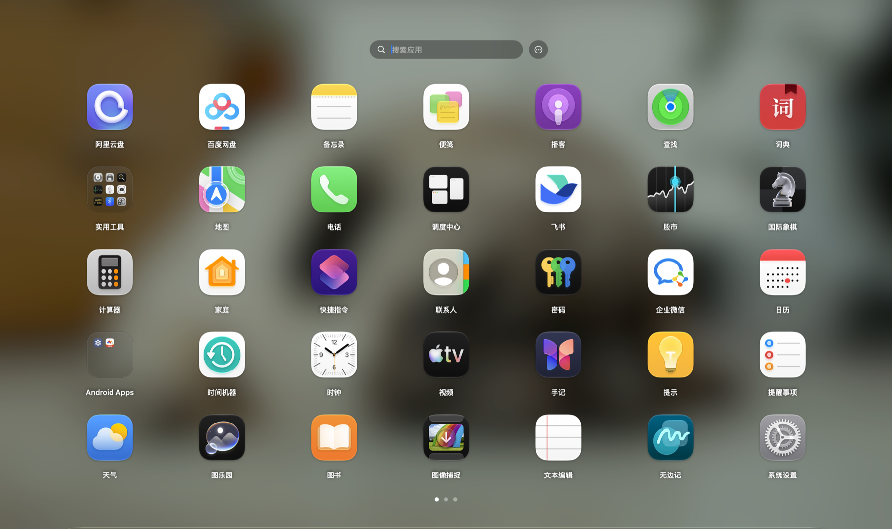
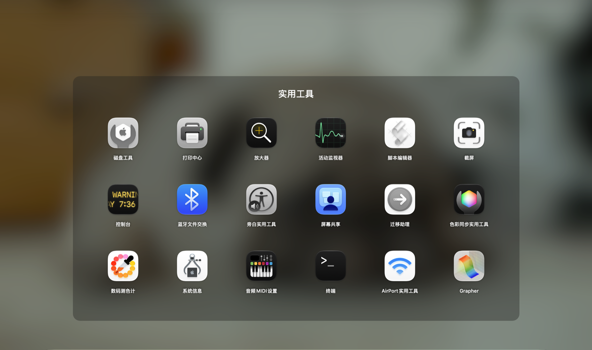
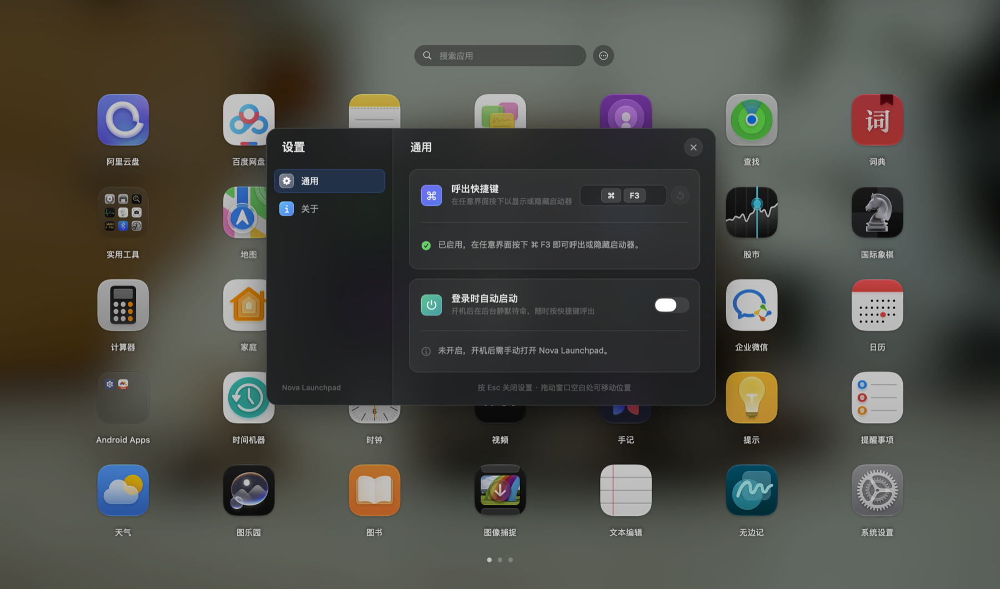

# Chu Launchpad

Chu Launchpad 是一个开源的 macOS 应用启动器，使用 Swift 和 AppKit 原生构建。它从系统与用户的 Applications 目录中发现应用，以接近 Launchpad 的全屏网格展示，并提供毛玻璃壁纸、文件夹、搜索和流畅翻页体验。

[](LICENSE)

## 实际运行效果

以下截图来自 Chu Launchpad 实际运行界面：

### 应用启动页



### 应用文件夹





## 功能

- 全屏应用网格、搜索过滤和页面滚动/触控板翻页
- 透明毛玻璃壁纸背景，图标与文件夹在背景上方清晰显示
- 文件夹展开与收起、应用右键菜单
- 按名称或添加日期排序，扫描应用目录并刷新列表
- GitHub Releases 更新检查、下载和重启安装
- 多显示器、Retina 屏幕与壁纸切换支持

应用扫描目录包括 `/Applications`、`/System/Applications` 和 `~/Applications`。目录变化会触发刷新，也可以从搜索框旁的设置菜单手动选择“刷新应用”。

## 系统要求

- macOS 14 或更高版本
- Swift 6 命令行工具
- 构建和运行无需完整 Xcode

## 构建与运行

```sh
./scripts/build.sh
open 'build/Chu Launchpad dev.app'
```

本地构建会生成独立的 `Chu Launchpad dev.app`，显示名称和 Bundle ID 都带 `dev`，可以与正式版并存。正式发布包通过 `scripts/package-release.sh` 构建，名称与 Bundle ID 不带 `dev`。正式版首次从 `/Applications` 或 `~/Applications` 启动时会尝试将应用固定到 Dock，并刷新 Dock；若已有图标或用户之后手动移除，不会重复添加。此功能依赖 macOS Dock 偏好，受系统版本、权限及设备管理策略影响。开发目录中的构建不会自动修改 Dock。调试构建命令：

```sh
CHU_DEBUG=1 ./scripts/build.sh
open 'build/Chu Launchpad dev.app'
```

运行回归检查：

```sh
./scripts/test.sh
```

## 安装包与发布

本地分别生成 Apple Silicon（arm64）和 Intel（x64）的 ZIP 更新包、DMG 安装包及 SHA-256 校验文件：

```sh
CHU_VERSION=1.2.3 CHU_ARCH=arm64 sh scripts/package-release.sh
CHU_VERSION=1.2.3 CHU_ARCH=x86_64 sh scripts/package-release.sh
```

向 GitHub 推送 `vX.Y.Z` 格式的版本标签后，GitHub Actions 会自动构建 arm64 与 Intel x64 安装包并创建 Release：

```sh
git tag -a v1.2.3 -m "Chu Launchpad 1.2.3"
git push origin v1.2.3
```

当前发布构建未签名或公证。首次打开时，macOS 可能要求在“系统设置 → 隐私与安全性”中确认打开。

## 开源许可

本项目基于 [Apache License 2.0](LICENSE) 开源。
